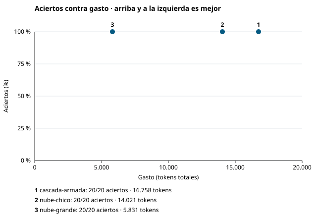

# Lab 1 · Decisión

## 1. Tabla de resultados
| Configuración | Aciertos | Inválidas | Tokens | Segundos | Costo estimado (USD) |
|---|---|---|---|---|---|
| cascada-armada | 20/20 | 0 | 16758 | 90.9 | 0.0 |
| nube-chico | 20/20 | 0 | 14021 | 58.5 | 0.0 |
| nube-grande | 20/20 | 0 | 5831 | 87.4 | 0.0 |

## 2. Gráfico

Las tres configuraciones con resultados iguales con en el máximo de aciertos y costo 0.
Gasto de tokens: `nube-grande` fue el que menos tokens consumió.
Rapidez: `nube-chico` fue considerablemente más rápido con respecto a las demas config.

## 3. Casos importantes
Considerando los resultados entre modelos:
- Coincidieron en la clasificación de aciertos de los 20 reclamos. Incluso en casos ambiguos (R17-R20).
- Diferencia de consumo entre modelos (R01–R20): La diferencia observable `nube-chico` consumió más del doble de tokens totales (14,021 vs. 5,831) para llegar exactamente al mismo resultado que `nube-grande`.

## 4. Regla de ruteo de modelos
| Tarea | Modelo o configuración | Por qué se elige | Riesgo y privacidad | Cuándo escalar |
|Clasificación de reclamos de LegacyPay|nube-chico(liquid/lfm-3-1.7b:free)|Mayor rápidez que el modelo grande a costo $0|Los reclamos de clientes pueden contener datossensibles|Cuando el modelo devuelva confianza baja, resultados inválidos o poco fiables.|
| | | | | |

## 5. Lo que el chequeo no verifica
En esta prueba de reclamos (R01-R20) no se identifico ningún caso de confianza alta con respuesta equivocada, ya que ambas configuraciones alcanzaron 20/20 aciertos. Aun asi considero que no se puede confiar 100% en modelos aun cuando dicen tener una confianza alta.
Para mejorar el chequeo se podría escalar a un modelo que permita validaciones por palabras criticas para reclamos como casos sospecha_fraude y tener una doble revision para asegurar casos de riesgo o ambiguos.
